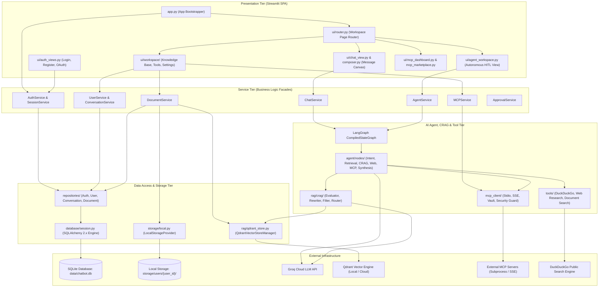
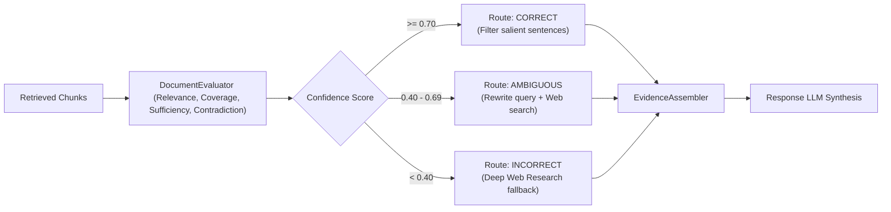

# QnAGPT – Production-Ready Multi-User Agentic AI Workspace

An enterprise-grade, pure light-mode **Multi-User Agentic AI Platform** powered by **Streamlit**, **LangChain**, **LangGraph**, **Groq Cloud LLMs**, **Hugging Face Dense Embeddings**, **Qdrant Vector Database** (`Local` & `Cloud`), **SQLAlchemy 2.x / SQLite / Alembic**, **Local Tenant Filesystem Storage**, **Model Context Protocol (MCP)**, **Corrective RAG (CRAG)**, and **Deep Web Research**.

---

## 1. Project Overview

**QnAGPT** is a production-oriented, multimodal AI workspace designed for multi-tenant enterprise environments. It bridges traditional document question-answering with stateful autonomous agent execution. Authenticated users can conduct multi-turn conversational AI sessions, ingest multi-format knowledge assets (PDF, TXT, DOCX, CSV, MD) with tenant-isolated vector search, run verified Corrective RAG (CRAG) pipelines that cross-verify internal documents against live web search, and execute external tools over standard Model Context Protocol (MCP) servers with cryptographic Human-in-the-Loop (HITL) safety gating.

---

## 2. Problem Statement

Modern enterprise generative AI applications face critical structural challenges:
1. **Hallucination in RAG**: Standard RAG pipelines retrieve top-$k$ vector chunks blindly and assume they are relevant and accurate. When chunks are irrelevant or outdated, models hallucinate.
2. **Tool-Call Fragility**: Combining tool-calling and response synthesis into a single prompt often causes models to hallucinate function execution (e.g. Harmony `browser.open` errors) or emit raw JSON schema blocks into user responses.
3. **Multi-Tenant Security Gaps**: Many AI prototypes lack proper tenant isolation, allowing users to potentially retrieve or query other users' indexed document chunks.
4. **Unsafe Agent Autonomy**: Autonomous agents executing shell commands, file modifications, or API writes without human approval introduce severe operational and security risks.

QnAGPT directly solves these challenges with **Corrective RAG (CRAG)**, **strict tenant payload isolation**, **Agent vs. Response LLM separation**, and **cryptographic Human-in-the-Loop (HITL) approval gates**.

---

## 3. Features

- **Multi-Tenant Authentication & Session Management**:
  - Secure email & password registration with **Argon2id** cryptographic password hashing.
  - Social Sign-In via **Google** and **GitHub** OAuth 2.0 / OIDC with **PKCE (RFC 7636)**.
  - In-memory/SQLite sliding-window rate limiting ($\le 5$ failed attempts per 300s).
  - Opaque URL-safe 32-byte bearer session tokens stored as HMAC-SHA256 digests.
- **Corrective Retrieval-Augmented Generation (CRAG)**:
  - Multi-dimensional chunk evaluation across relevance, coverage, sufficiency, and contradictions.
  - Deterministic confidence routing: `CORRECT` (salient sentence extraction), `AMBIGUOUS` (query rewrite + web search augmentation), `INCORRECT` (deep web research fallback), and `CONTRADICTORY` (dual perspective framing).
  - Anaphora resolution and semantic query decomposition via `QueryRewriter`.
  - Sentence-level evidence filtering and deduplication via `DocumentFilter`.
- **Tenant-Isolated Knowledge Base**:
  - Ingestion for PDF (`pypdf`), Word (`docx2txt`), CSV (`csv.DictReader`), and Markdown/Text.
  - Local embeddings via `sentence-transformers/all-MiniLM-L6-v2` (zero external embedding API costs).
  - Vector indexing in **Qdrant** with mandatory `user_id` payload filters.
  - Offline upload resilience: raw files are saved locally; if Qdrant is unreachable, users can re-index with a single click once online.
- **Deep Web Research**:
  - Free public web discovery via **DuckDuckGo** (`ddgs`).
  - SSRF-safe webpage fetcher (`SafeWebPageReader`) blocking loopback, RFC1918 subnets, and cloud metadata endpoints.
  - Clean HTML parsing, Markdown table extraction, and cross-source entity verification.
- **Model Context Protocol (MCP) Integration**:
  - Full client support for `stdio` subprocesses and `streamable_http`/`sse` remote servers.
  - Live marketplace browsing against the **Official MCP Registry** and **Glama AI Directory**.
  - Local credential vault encrypted with **Fernet (AES-128-CBC + HMAC-SHA256)**.
  - Human-in-the-Loop (HITL) approval gating for `MODIFICATION` and `SENSITIVE` tools.
- **Enterprise Light-Mode UI**:
  - Responsive Single-Page Application (SPA) built with Streamlit and 26 KB of custom CSS.
  - Thread navigation drawer grouped by date buckets ("Today", "Yesterday", "Previous 7 Days").
  - Export conversations to **JSON**, **Markdown**, or **Plain Text**.

---

## 4. Technology Stack

| Layer | Technologies |
| :--- | :--- |
| **Language & Runtime** | Python 3.12+, `uv` Package Manager |
| **Frontend & UI** | Streamlit 1.41+, Custom Pure Light-Mode CSS Design Tokens |
| **Agent & Workflow** | LangChain, LangGraph (`StateGraph`), `SqliteSaver` Checkpointing |
| **LLM Inference** | Groq Cloud API (`openai/gpt-oss-20b`, `openai/gpt-oss-120b`, `qwen/qwen3.8-27b`) |
| **Embeddings** | Hugging Face `sentence-transformers/all-MiniLM-L6-v2` |
| **Vector Storage** | Qdrant (Local Docker or Managed Cloud), FAISS (Local Fallback) |
| **Relational Database** | SQLite 3, SQLAlchemy 2.x, Alembic Migrations |
| **Security & Auth** | `argon2-cffi` (Argon2id), `Authlib` (OAuth2 PKCE), `cryptography` (Fernet) |
| **Document Loaders** | `pypdf`, `docx2txt`, `beautifulsoup4`, `httpx` |
| **Web Research** | `duckduckgo-search` (`ddgs`), `httpx` |
| **Testing** | Pytest, Streamlit `AppTest` |

---

## 5. Architecture

The application is structured into five distinct, decoupled architectural tiers:
1. **Presentation Tier (`qna_bot/ui/`)**: Pure Streamlit UI components, light-mode design system, and the decoupled workspace router (`ui/router.py`).
2. **Service Tier (`qna_bot/services/`)**: High-level domain facades mediating business logic and transaction boundaries.
3. **AI Agent & RAG Tier (`qna_bot/agent/`, `qna_bot/rag/`)**: Compiled LangGraph state machine, decomposed node handlers (`nodes/`), and Corrective RAG pipeline (`crag/`).
4. **Data Access Tier (`qna_bot/repositories/`, `qna_bot/storage/`)**: SQLAlchemy 2.x ORM repositories and path-traversal-safe local file storage.
5. **External Infrastructure**: Groq Cloud LLM API, Qdrant vector engine, DuckDuckGo, and external MCP servers.

---

## 6. Mermaid Architecture Diagram



---

## 7. Complete Repository Tree

```
langchain_01/
├── alembic.ini                                # Relational migration configuration
├── pyproject.toml                             # Packaging, build specs, console scripts
├── requirements.txt                           # Deployment dependencies lock
├── .env / .env.example                        # Environment variables & secrets
├── migrations/                                # Alembic schema migrations
│   ├── env.py                                 # Alembic environment runner
│   └── versions/
│       └── 0001_initial_platform_schema.py   # Baseline SQLAlchemy platform schema
├── docs/                                      # Engineering & architectural documentation
│   ├── AGENT_ARCHITECTURE.md
│   ├── API_REFERENCE.md
│   ├── APPLICATION_WORKFLOW.md
│   ├── ARCHITECTURE.md
│   ├── AUTHENTICATION_FLOW.md
│   ├── BACKUP_AND_RESTORE.md
│   ├── DATABASE_DESIGN.md
│   ├── DEVELOPMENT_GUIDE.md
│   ├── HLD.md
│   ├── LLD.md
│   ├── MCP_ARCHITECTURE.md
│   ├── SECURITY.md
│   └── TROUBLESHOOTING.md
├── reports/                                   # Audit & discovery reports
│   ├── DEPENDENCY_MAP.md
│   ├── FILE_RESPONSIBILITY_MAP.md
│   ├── INITIAL_ARCHITECTURE_AUDIT.md
│   ├── REPOSITORY_DISCOVERY.md
│   ├── RESTRUCTURING_CHANGELOG.md
│   └── RESTRUCTURING_PLAN.md
├── qna_bot/                                   # Core Application Package
│   ├── __init__.py                            # Package init & path sanitizer
│   ├── __main__.py                            # python -m qna_bot launcher
│   ├── app.py                                 # Streamlit SPA application orchestrator
│   ├── cli.py                                 # qna-bot CLI console entry
│   ├── agent/                                 # LangGraph Agent Subsystem
│   │   ├── approval.py                        # HITL approval tokens & requests
│   │   ├── graph.py                           # StateGraph assembly & conditional edges
│   │   ├── mcp_adapter.py                     # LangChain StructuredTool wrapper for MCP
│   │   ├── memory.py                          # SqliteSaver checkpointer
│   │   ├── prompts.py                         # System prompts, rubrics & instructions
│   │   ├── routing.py                         # Conditional edge predicates
│   │   ├── state.py                           # AgentState TypedDict
│   │   └── nodes/                             # Decomposed Node Handlers
│   │       ├── __init__.py                    # Composite AgentNodeSuite & public exports
│   │       ├── base.py                        # BaseNodeSuite, LLM factories, schemas
│   │       ├── crag.py                        # CRAGNodesMixin (grade_documents)
│   │       ├── intent.py                      # IntentNodesMixin (analyze_query, rewrite_query)
│   │       ├── mcp_exec.py                    # MCPNodesMixin (plan, select, approve, execute)
│   │       ├── retrieval.py                   # RetrievalNodesMixin (retrieve_documents)
│   │       ├── synthesis.py                   # SynthesisNodesMixin (generate, direct, validate)
│   │       └── web.py                         # WebNodesMixin (search, open, cross_verify)
│   ├── config/settings.py                     # AppSettings dataclass & dynamic loader
│   ├── core/                                  # Foundation Primitives
│   │   ├── exceptions.py                      # Standardized exception taxonomy
│   │   ├── logging_config.py                  # Centralized structured logging
│   │   └── security.py                        # Argon2id hashing & secure tokens
│   ├── database/                              # Persistence Engine
│   │   ├── connection.py                      # Direct SQLite connection manager
│   │   ├── legacy_migration.py                # Dynamic schema compatibility bridge
│   │   ├── models.py                          # Dataclass records
│   │   ├── repositories.py                    # Raw SQL data access layer
│   │   └── session.py                         # SQLAlchemy 2.x engine & scoped session factory
│   ├── mcp_client/                            # Canonical Isolated MCP Subsystem
│   │   ├── client_manager.py                  # Client connection pool & tool execution
│   │   ├── config.py                          # Transport configuration dataclasses
│   │   ├── connection.py                      # Stdio subprocess & SSE transports
│   │   ├── credentials.py                     # AES-Fernet credential encryption vault
│   │   ├── exceptions.py                      # MCP protocol exceptions
│   │   ├── models.py                          # Transport schemas & permission enums
│   │   ├── oauth.py                           # MCP OAuth2 PKCE authorization flows
│   │   ├── permissions.py                     # Tool authorization policy evaluator
│   │   ├── prompt_manager.py                  # MCP Prompt template handler
│   │   ├── resource_manager.py                # MCP Resource handler
│   │   ├── security.py                        # SSRF IP validator & command sanitizer
│   │   ├── server_registry.py                 # Local server configuration manager
│   │   ├── tool_registry.py                   # Discovered tool cache
│   │   └── registry/                          # Marketplace Providers
│   │       ├── base.py                        # Abstract registry provider
│   │       ├── glama_provider.py              # Glama AI MCP directory provider
│   │       ├── models.py                      # Registry search models
│   │       ├── official_provider.py           # Official MCP registry provider
│   │       └── service.py                     # Aggregated registry search service
│   ├── mcp/                                   # Backward-Compatibility Facade
│   ├── models/                                # Declarative SQLAlchemy 2.x ORM Models
│   │   ├── audit.py                           # AuditLog ORM model
│   │   ├── base.py                            # DeclarativeBase & TimestampMixin
│   │   ├── conversation.py                    # Thread, Message, ConversationFeedback
│   │   ├── document.py                        # Document, DocumentChunk
│   │   ├── mcp.py                             # MCPServer, ToolPermission, EncryptedCredential
│   │   └── user.py                            # User, AuthIdentity, UserSession, UserSetting
│   ├── rag/                                   # RAG & Vector Engine Subsystem
│   │   ├── chunking.py                        # Recursive character text splitting
│   │   ├── embeddings.py                      # Sentence-transformers local embeddings cache
│   │   ├── grader.py                          # Fallback document grader
│   │   ├── ingestion.py                       # Ingestion pipeline binding loader + chunker
│   │   ├── loaders.py                         # Multi-format document parser
│   │   ├── qdrant_store.py                    # Primary Qdrant vector store manager
│   │   ├── retriever.py                       # Scoped retriever returning RetrievedChunk
│   │   ├── vector_store.py                    # Fallback FAISS vector store manager
│   │   └── crag/                              # Corrective RAG (CRAG) Engine
│   │       ├── document_filter.py             # Sentence extraction & deduplication
│   │       ├── evaluator.py                   # Multi-dimensional document evaluator
│   │       ├── evidence.py                    # EvidenceBundle & citations
│   │       ├── exceptions.py                  # CRAG domain exceptions
│   │       ├── metrics.py                     # CRAG metrics tracker
│   │       ├── models.py                      # CRAG data models & enums
│   │       ├── pipeline.py                    # CRAG execution pipeline
│   │       ├── query_rewriter.py              # Semantic query decomposition
│   │       └── routing.py                     # CRAG decision router
│   ├── repositories/                          # SQLAlchemy 2.x Data Access Layer
│   │   ├── auth_repository.py                 # User & session data access
│   │   ├── conversation_repository.py         # Thread & message persistence
│   │   ├── document_repository.py             # Document & chunk index metadata
│   │   └── user_repository.py                 # User preferences & account CRUD
│   ├── schemas/                               # Pydantic v2 DTOs
│   │   ├── auth.py                            # Authentication & registration DTOs
│   │   └── workspace.py                       # Workspace configuration DTOs
│   ├── services/                              # Business Logic Facades
│   │   ├── agent_service.py                   # Autonomous agent cycle orchestrator
│   │   ├── approval_service.py                # HITL approval lifecycle
│   │   ├── auth_service.py                    # Authentication & rate limiting
│   │   ├── chat_service.py                    # Streaming chat & graph execution
│   │   ├── conversation_service.py            # Thread management & date bucketing
│   │   ├── document_service.py                # Document ingestion orchestration
│   │   ├── export_service.py                  # Conversation export (JSON, MD, TXT)
│   │   ├── image_service.py                   # Multimodal vision image prep
│   │   ├── mcp_service.py                     # MCP server & tool manager facade
│   │   ├── session_service.py                 # Session lifecycle
│   │   ├── suggestion_service.py              # Starter suggestion chips
│   │   └── user_service.py                    # User profile & account management
│   ├── storage/                               # Physical Document Storage Providers
│   │   ├── base.py                            # StorageProvider abstract base
│   │   └── local.py                           # LocalStorageProvider (tenant path-traversal safe)
│   ├── tools/                                 # Built-in Agent Tools
│   │   ├── document_tools.py                  # Document search tool
│   │   ├── web_research.py                    # SSRF-safe page fetcher & extractor
│   │   └── web_search.py                      # DuckDuckGo search integration
│   └── ui/                                    # Streamlit Presentation Layer
│       ├── agent_workspace.py                 # Autonomous agent workspace view
│       ├── auth_views.py                      # Login, registration, OAuth views
│       ├── chat_view.py                       # Streaming message canvas & citations
│       ├── components.py                      # Badges, metric cards, timeline events
│       ├── composer.py                        # Chat composer input & suggestions
│       ├── design_system.py                   # Light-mode design tokens
│       ├── mcp_dashboard.py                   # MCP server management dashboard
│       ├── mcp_marketplace.py                 # MCP marketplace browser & installer
│       ├── router.py                          # Dedicated page router (decouples app.py)
│       ├── sidebar.py                         # Thread navigation sidebar
│       ├── styles.py                          # Stylesheet injector
│       ├── workspace_views.py                 # Backward-compatibility facade
│       ├── workspace/                         # Modular workspace management views
│       │   ├── __init__.py
│       │   ├── knowledge_base_view.py         # Knowledge base document upload table
│       │   ├── marketplace_view.py            # Tool permissions & audit view
│       │   └── settings_view.py               # Application settings view
│       └── assets/styles.css                  # Custom light-mode CSS (26 KB)
└── tests/                                     # Automated Test Suite (20 files, 110 tests)
```

---

## 8. File and Module Responsibilities

See [reports/FILE_RESPONSIBILITY_MAP.md](reports/FILE_RESPONSIBILITY_MAP.md) for the exhaustive catalogue of every file. Primary modules include:

- **`qna_bot/app.py`**: Web application entry point; initializes configuration, session state, styles, platform services, and sidebar. Delegates workspace rendering to `router.py`.
- **`qna_bot/ui/router.py`**: Decoupled workspace router dispatching between Knowledge Base, Tool Marketplace, Settings, Account, Agent Workspace, and Chat Canvas.
- **`qna_bot/agent/graph.py`**: Compiles the LangGraph `StateGraph` with 21 nodes, conditional edges, and `SqliteSaver`.
- **`qna_bot/agent/nodes/`**: Decomposed node handlers (`intent.py`, `retrieval.py`, `crag.py`, `web.py`, `mcp_exec.py`, `synthesis.py`, `base.py`).
- **`qna_bot/rag/crag/`**: Corrective RAG engine (`evaluator.py`, `query_rewriter.py`, `document_filter.py`, `evidence.py`, `routing.py`, `metrics.py`).
- **`qna_bot/mcp_client/`**: Model Context Protocol client implementation with `stdio` subprocesses, `sse` transports, and encrypted vaults.
- **`qna_bot/database/session.py`**: Scoped SQLAlchemy 2.x session provider with WAL PRAGMAs.

---

## 9. Application Startup Workflow

1. User invokes `streamlit run qna_bot/app.py` or console script `qna-bot`.
2. `qna_bot/__init__.py` runs `sanitize_import_path()`, ensuring the workspace root is at `sys.path[0]`.
3. `qna_bot/app.py` loads `AppSettings`, configures structured logging, and injects light-mode styles (`styles.css`).
4. `_get_shared_orm_db()` initializes the SQLAlchemy 2.x engine and connection pool for `data/chatbot.db`.
5. `ensure_legacy_workspace_synced()` inspects table schemas dynamically to add any missing columns.
6. `build_platform_services()` initializes database, storage, vector store, and authentication facades.

---

## 10. Request Lifecycle

1. User submits a message in `render_chat_composer()`.
2. `ChatService.stream_response()` appends the user message to SQLite and invokes `CompiledStateGraph`.
3. `analyze_query_node` determines intent (`GENERAL`, `DOCUMENT`, `WEB_SEARCH`, `AGENT_TASK`).
4. In `DOCUMENT` / `AUTO` mode, `retrieve_documents_node` searches Qdrant using the user's isolated payload filter.
5. `crag_evaluate_documents_node` grades retrieved chunks. The router directs high-confidence evidence to synthesis, ambiguous evidence to query rewrite + web search, and low-confidence evidence to deep research.
6. `synthesize_response_node` (an unbound Response LLM) generates the final answer.
7. `validate_answer` checks for hallucinations. Tokens are streamed back to the user canvas.

---

## 11. Authentication & Authorization Workflow

See [docs/AUTHENTICATION_FLOW.md](docs/AUTHENTICATION_FLOW.md) for sequence diagrams and specifications:
- **Email & Password**: Argon2id cryptographic hashing with automatic salt generation via `argon2-cffi`.
- **Rate Limiting**: Sliding window tracking failed login attempts ($\le 5$ attempts per 300 seconds).
- **OAuth 2.0 PKCE**: Authlib client with SHA-256 PKCE challenge exchange for Google and GitHub.
- **Session Tokens**: Opaque 32-byte URL-safe bearer tokens hashed with HMAC-SHA256 and matched against active records in `user_sessions`.

---

## 12. Database Workflow

See [docs/DATABASE_DESIGN.md](docs/DATABASE_DESIGN.md) for full ERD and column definitions:
- **Engine**: SQLite 3 with WAL mode, foreign key enforcement, and a 10-second busy timeout.
- **Migrations**: Alembic migrations under `migrations/versions/0001_initial_platform_schema.py`.
- **Dynamic Bridge**: `ensure_legacy_workspace_synced()` inspects tables on startup and automatically alters missing columns.

---

## 13. API Documentation

See [docs/API_REFERENCE.md](docs/API_REFERENCE.md) for complete signatures:
- **Inbound Routes**: `GET /` (Web SPA), `GET /?code=...&state=...` (OAuth2 Callback).
- **Service Interfaces**: Public contracts for `AuthService`, `UserService`, `ChatService`, `DocumentService`, `MCPService`, `ApprovalService`, and `ExportService`.
- **External Endpoints**: Groq Cloud completions API, Qdrant REST/gRPC endpoints, DuckDuckGo search endpoints, and MCP registry directories.

---

## 14. AI / LLM Workflow

- **Decoupled LLM Architecture**:
  - `_make_agent_llm()` binds tools with `tool_choice="auto"` for function selection.
  - `_make_response_llm()` is strictly unbound from tools for plain-text response generation, preventing Harmony `browser.open` errors.
- **Supported Models**:
  - `openai/gpt-oss-20b` (Default lightweight text and tool model)
  - `openai/gpt-oss-120b` (High-capacity reasoning model)
  - `qwen/qwen3.8-27b` (Multimodal vision model for image attachments)

---

## 15. RAG & Corrective RAG (CRAG) Workflow



---

## 16. Agent Execution Workflow

In **Agent Workspace** mode:
1. `plan_task` decomposes user goals into sequential steps.
2. `select_tools` identifies appropriate MCP or built-in tools.
3. `check_permissions` evaluates tool governance policy:
   - `ALLOW_ALWAYS` $\rightarrow$ Executes directly.
   - `REQUIRE_APPROVAL` $\rightarrow$ Graph interrupts; UI renders approval card; user reviews parameters; upon approval, `Command(resume=...)` resumes execution.
4. `observe_results` records audit logs with masked arguments and evaluates progress.

---

## 17. MCP Workflow

See [docs/MCP_ARCHITECTURE.md](docs/MCP_ARCHITECTURE.md):
- **Transports**: Subprocess `stdio` with command allowlists; remote `streamable_http` and `sse` with private IP SSRF filters.
- **Credential Encryption**: Fernet AES-128-CBC encryption stored in `data/.mcp_vault.key`.
- **Discovery**: Live search across Official Registry (`registry.modelcontextprotocol.io`) and Glama AI (`glama.ai/api/mcp/v1`).

---

## 18. Memory Management

- **LangGraph Checkpointing**: Session execution graphs are saved in SQLite using `SqliteSaver`.
- **Long-Term Storage**: Chat threads and messages are persisted in `conversations` and `messages` tables.
- **Time Bucketing**: Sidebar organizes conversations into "Today", "Yesterday", "Previous 7 Days", "Previous 30 Days", and "Older".

---

## 19. Environment Variables

All settings are configured in `.env` (see [`.env.example`](.env.example)):

| Variable | Required | Default | Description |
| :--- | :---: | :---: | :--- |
| `GROQ_API_KEY` | **Yes** | — | Groq Cloud API key for LLM inference |
| `LOG_LEVEL` | No | `INFO` | Logging level (`DEBUG`, `INFO`, `WARNING`, `ERROR`) |
| `DATABASE_URL` | No | `sqlite:///./data/chatbot.db` | SQLAlchemy database connection string |
| `QDRANT_MODE` | No | `local` | `local` (Docker/localhost) or `cloud` |
| `QDRANT_URL` | No | `http://localhost:6333` | Qdrant vector database URL |
| `QDRANT_API_KEY` | No | `""` | API key for Qdrant Cloud |
| `QDRANT_COLLECTION`| No | `qna_documents` | Target Qdrant collection name |
| `APP_BASE_URL` | No | `http://localhost:8501` | Public application base URL for OAuth callbacks |
| `GOOGLE_CLIENT_ID` | No | `""` | Google OAuth2 Client ID |
| `GOOGLE_CLIENT_SECRET`| No | `""` | Google OAuth2 Client Secret |
| `GITHUB_CLIENT_ID` | No | `""` | GitHub OAuth2 Client ID |
| `GITHUB_CLIENT_SECRET`| No | `""` | GitHub OAuth2 Client Secret |
| `CRAG_ENABLED` | No | `true` | Enable Corrective RAG evaluation |
| `CRAG_CONFIDENCE_THRESHOLD` | No | `0.70` | Confidence cutoff for `CORRECT` route |
| `GLAMA_API_KEY` | No | `""` | Optional key for Glama MCP registry search |

---

## 20. Installation Instructions

Using `uv` (recommended):
```powershell
git clone https://github.com/alindapal07/QnAGPT-Personalised-ChatBot.git
cd langchain_01
uv sync
```

Using standard `pip`:
```powershell
python -m venv .venv
.\.venv\Scripts\Activate.ps1
pip install -r requirements.txt
```

---

## 21. Local Development Setup

1. Copy `.env.example` to `.env`:
   ```powershell
   Copy-Item .env.example .env
   ```
2. Add your `GROQ_API_KEY` in `.env`.
3. Apply database migrations:
   ```powershell
   uv run alembic upgrade head
   ```

---

## 22. Docker Setup

To run the local Qdrant vector store in Docker:
```powershell
docker run -d --name qnagpt-qdrant `
  -p 6333:6333 -p 6334:6334 `
  -v "${PWD}\data\qdrant_storage:/qdrant/storage" `
  qdrant/qdrant:latest
```

---

## 23. Running the Application

### Via Streamlit Runner:
```powershell
uv run streamlit run qna_bot/app.py
```

### Via Console Command:
```powershell
uv run qna-bot
```

Open your browser at `http://localhost:8501`.

---

## 24. Running Tests

The test suite contains 110 automated tests:
```powershell
# Run all tests (offline)
uv run pytest -v -k "not test_app_renders_all_workspace_pages_cleanly"

# Run Corrective RAG unit tests
uv run pytest tests/test_crag.py -v

# Run LangGraph Agent tests
uv run pytest tests/test_agent.py -v

# Run MCP client & security tests
uv run pytest tests/test_mcp_client.py tests/test_mcp_security.py -v
```

---

## 25. Troubleshooting

See [docs/TROUBLESHOOTING.md](docs/TROUBLESHOOTING.md) for detailed diagnostics:
- **`OperationalError: no such column: is_pinned`**: Run `uv run alembic upgrade head` or allow the dynamic startup bridge to patch columns automatically.
- **`groq.APIConnectionError`**: Verify your `GROQ_API_KEY` is active and unblocked by firewalls.
- **`ModuleNotFoundError: No module named 'mcp'`**: In v2.0.0, the package is renamed to `qna_bot.mcp_client` to prevent collisions with the official PyPI SDK.
- **Qdrant Connection Refused**: Start your local Docker container or set `QDRANT_MODE=cloud`. Uploaded files are preserved locally, allowing one-click retry.

---

## 26. Production Deployment

### Streamlit Community Cloud:
1. Push repository to GitHub.
2. In Streamlit Cloud dashboard, set Main file path to `qna_bot/app.py`.
3. Add `GROQ_API_KEY` (and optional OAuth credentials) under **App settings $\rightarrow$ Secrets**.
4. The deployment automatically reads `requirements.txt`.

### Linux / Container Deployment:
Run with production workers behind Nginx with SSL termination:
```bash
streamlit run qna_bot/app.py --server.port 8501 --server.address 0.0.0.0
```

---

## 27. Security Considerations

See [docs/SECURITY.md](docs/SECURITY.md):
- **Password Security**: Argon2id hashing with unique random salts.
- **Session Protection**: Bearer tokens are stored only as HMAC-SHA256 digests.
- **SSRF Defense**: `SafeWebPageReader` blocks private subnets (`127.0.0.0/8`, `10.0.0.0/8`, `192.168.0.0/16`, `169.254.0.0/16`).
- **Command Sanitization**: Stdio MCP transports block shell chaining metacharacters (`;`, `&`, `|`, `` ` ``, `$`).
- **Vault Encryption**: Fernet AES-128-CBC encryption for MCP API keys and OAuth tokens.

---

## 28. Known Limitations

- **Concurrent Write Bottleneck on SQLite**: While SQLite WAL mode allows concurrent readers, multiple simultaneous writes are serialized with a 10-second busy timeout.
- **Local Embedding Memory**: `sentence-transformers/all-MiniLM-L6-v2` runs in-process on CPU, requiring ~200 MB RAM.
- **Public MCP Registries Offline Access**: Browsing official and Glama registries requires active internet connectivity.
