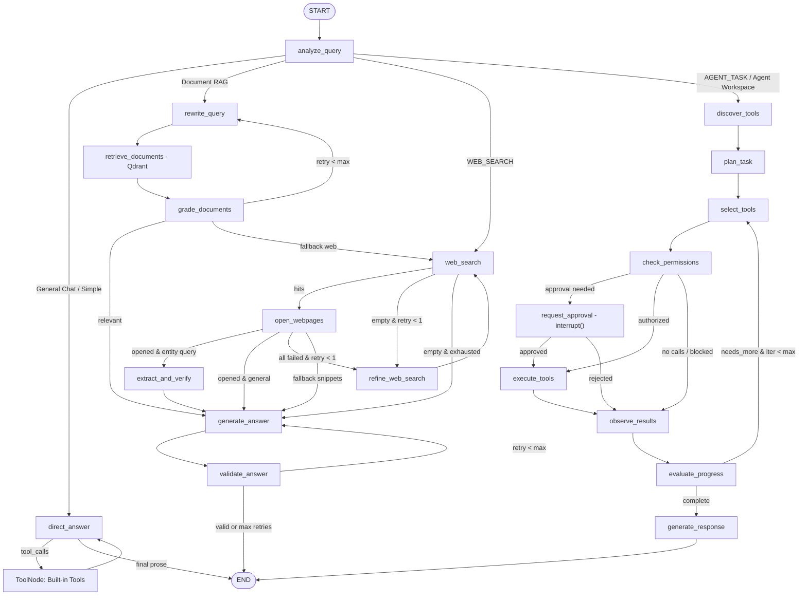

# QnAGPT LangGraph Agent & Deep Web Research Architecture

## 1. Graph Topology & Routing

## 2. Agent LLM vs Response LLM Separation & Tool Compatibility

- **Agent LLM (`_make_agent_llm`)**: Explicitly binds schemas with `tool_choice="auto"` when supported (`ChatGroq` models such as `openai/gpt-oss-20b`, `openai/gpt-oss-120b`, `qwen/qwen3.8-27b`) and filters/caps dynamically bound MCP tools (`max 35` relevant MCP tools + built-ins) alongside system guidance against unregistered Harmony `browser.open` syntax.
- **Non-Native / Fallback Routing**: Models or turns without native tool calling use deterministic query analysis + controlled LangGraph routing (`web_search -> open_webpages -> extract_and_verify -> generate_answer`) without passing invalid `tools`/`tool_choice` parameters.
- **Response LLM (`_make_response_llm`)**: Never binds tools. Prior `AIMessage(tool_calls=...)` and `ToolMessage` items are converted into flat untrusted context blocks via `_messages_for_response_llm` so Harmony models never hallucinate `browser.open` under `tool_choice="none"`, backed by a safe single-retry guard for `tool_use_failed`.

## 3. Real-Time Execution Progress Events

`ChatService._consume_stream` transforms real LangGraph `stream_mode="updates"` node emissions into structured progress events (`pending`, `running`, `completed`, `failed`, `skipped`) with timing and sanitized counts (chunks retrieved, pages opened, MCP server & tool name, duration). Internal chain-of-thought and raw secrets are never exposed.

## 4. Checkpointer Isolation

Every LangGraph thread uses `thread_id = f"{user_id}:{conversation_id}"` inside `SqliteSaver` (`LANGGRAPH_CHECKPOINT_DB`), ensuring checkpoint state is isolated per authenticated user and decoupled from UI conversation rows.
