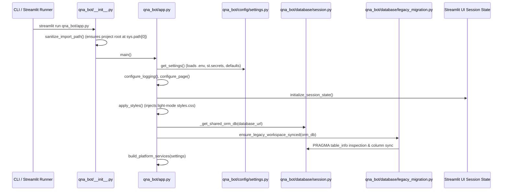
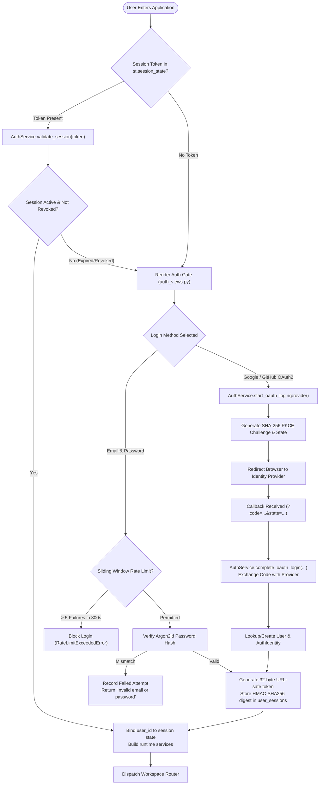
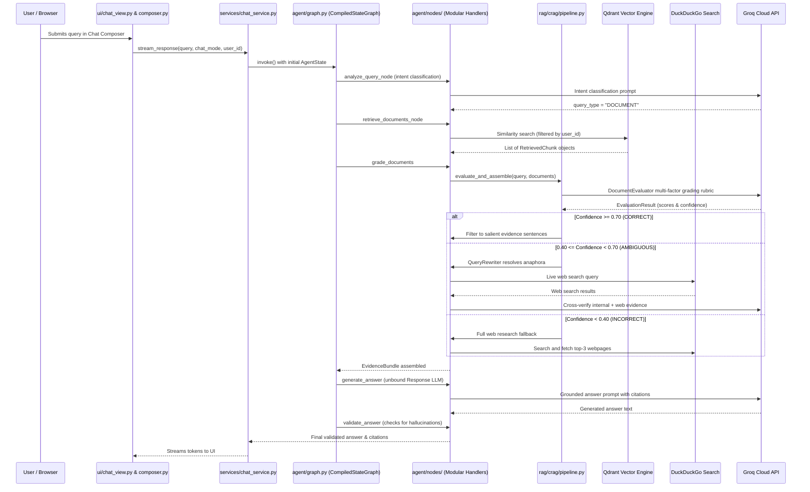

# QnAGPT Application Lifecycle & End-to-End Workflows

**Project**: QnAGPT – Production-Ready Multi-User Agentic AI Workspace  
**Status**: Verified Implementation  
**Author**: Principal Software Architect & Senior Python Backend Engineer  

---

## 1. Startup & Bootstrapping Workflow



1. **Path Sanitation**: `qna_bot/__init__.py` runs `sanitize_import_path()` to ensure the project root is at index 0 of `sys.path`.
2. **Configuration Hot-Reloading**: `get_settings()` inspects file modification signatures of `.env` and `.env.local`, merging active process variables and `st.secrets` into an immutable `AppSettings` dataclass.
3. **Database Connection Pool**: `_get_shared_orm_db()` caches a singleton `SQLAlchemyDatabase` instance with WAL mode and `PRAGMA busy_timeout = 10000`.
4. **Schema Synchronization**: `ensure_legacy_workspace_synced()` inspects table schemas dynamically to apply non-destructive backward-compatibility migrations (such as adding `is_pinned` to `threads` if absent).
5. **Platform Services Instantiation**: Factory `build_platform_services()` instantiates `LocalStorageProvider`, `QdrantVectorStoreManager`, `AuthService`, and `UserService`.

---

## 2. Authentication & Authorization Lifecycle



1. **Session Resolution**: Every request checks `st.session_state.auth_session_token`. The token is hashed with HMAC-SHA256 and matched against `user_sessions` where `revoked_at IS NULL` and `expires_at > now`.
2. **Rate Limiting**: `SlidingWindowRateLimiter` enforces a strict ceiling of $\le 5$ failed attempts per 300 seconds per client key.
3. **Argon2id Hashing**: Passwords are cryptographically salted and hashed using `argon2-cffi`. Plaintext passwords never enter log streams or database records.
4. **OAuth2 PKCE Handshake**: Complies with RFC 7636 Proof Key for Code Exchange (PKCE) with cryptographically random state tokens to prevent CSRF attacks.

---

## 3. Document Ingestion & Chunking Workflow

```mermaid
flowchart LR
    UPLOAD["Uploaded File (PDF, DOCX, CSV, TXT, MD)"] --> VALIDATE["DocumentService.validate_upload()<br/>(Check MIME, Size <= 20 MB)"]
    VALIDATE --> SAVE_DISK["LocalStorageProvider.save_file()<br/>storage/users/{user_id}/documents/"]
    SAVE_DISK --> EXTRACT["rag/loaders.py: load_document()<br/>(pypdf, docx2txt, csv.DictReader)"]
    EXTRACT --> CHUNK["rag/chunking.py: chunk_text()<br/>(Recursive Splitter: 1000/200)"]
    CHUNK --> EMBED["rag/embeddings.py<br/>(sentence-transformers all-MiniLM-L6-v2)"]
    EMBED --> STORE[("Qdrant Vector Store<br/>Payload: user_id, document_id, page")]
    STORE --> RECORD_DB[("SQLAlchemy Document Repository<br/>Status: 'indexed'")]
```



1. **Validation**: Files are checked against `settings.allowed_document_types` and `settings.max_document_size_mb`.
2. **Tenant Directory Isolation**: The original raw file is written to `storage/users/{user_id}/documents/{document_id}_{filename}` with path traversal safeguards.
3. **Multi-Format Extraction**: Text is extracted based on file extension (`pypdf` for PDF, `docx2txt` for DOCX, standard `csv` reader, UTF-8 text loader).
4. **Recursive Chunking**: Chunks are generated with 1,000 characters length and 200 characters overlap.
5. **Dense Vector Indexing**: Chunks are embedded locally using `sentence-transformers/all-MiniLM-L6-v2` (384 dimensions) and inserted into Qdrant with payload metadata filters (`user_id`, `document_id`, `source`, `page`).

---

## 4. Chat Request Turn & Corrective RAG (CRAG) Workflow



---

## 5. Autonomous Agent Workspace & HITL Execution Workflow

```mermaid
sequenceDiagram
    participant User as User (Streamlit UI)
    participant AgentSvc as services/agent_service.py
    participant Graph as agent/graph.py (CompiledStateGraph)
    participant MCP as mcp_client/client_manager.py
    participant Appr as services/approval_service.py
    participant Server as External MCP Server (Stdio / SSE)

    User->>AgentSvc: Submits complex goal in Agent Workspace
    AgentSvc->>Graph: invoke() in "Agent Workspace" mode
    Graph->>Graph: plan_task (breaks goal into sequential steps)
    loop For each planned step
        Graph->>Graph: select_tools (Agent LLM selects tool & arguments)
        Graph->>Graph: check_permissions (evaluates permission category)

        alt Tool Permission == "ALLOW_ALWAYS" (READ_ONLY)
            Graph->>MCP: execute_tool(namespaced_tool_name, arguments)
            MCP->>Server: Run tool over stdio/SSE
            Server-->>MCP: Tool result output
            MCP-->>Graph: ToolMessage with result
        else Tool Permission == "REQUIRE_APPROVAL" (MODIFICATION / SENSITIVE)
            Graph->>Appr: create_pending_approval(tool, arguments, reason)
            Graph->>Graph: interrupt(pending_approval)
            Graph-->>User: Halts graph; UI displays Approval Card

            User->>User: Reviews tool parameters & masked arguments
            User->>AgentSvc: Clicks "Approve Action" or "Reject Action"
            AgentSvc->>Appr: verify_and_consume(approval_id)
            AgentSvc->>Graph: Command(resume={"approved": true})

            alt Human Approved
                Graph->>MCP: execute_tool(tool, arguments)
                MCP->>Server: Run tool over stdio/SSE
                Server-->>MCP: Tool result output
                MCP-->>Graph: ToolMessage
            else Human Rejected
                Graph->>Graph: Append "Action rejected by user" ToolMessage
            end
        end

        Graph->>Graph: observe_results & evaluate_progress
    end

    Graph->>Graph: generate_response (synthesizes completed steps)
    Graph-->>AgentSvc: Final task response
    AgentSvc-->>User: Displays completed plan and execution timeline
```

---

## 6. Conversation Export Workflow

The application supports one-click serializations of conversation threads:
1. **JSON Export (`export_as_json`)**: Exports complete metadata, message roles, timestamps, tool calls, and model names in RFC 8259 JSON.
2. **Markdown Export (`export_as_markdown`)**: Exports a human-readable Markdown transcript formatted with blockquotes, headers, and bulleted citations.
3. **Plain Text Export (`export_as_text`)**: Clean text document suitable for copy-pasting or archival without formatting tags.
