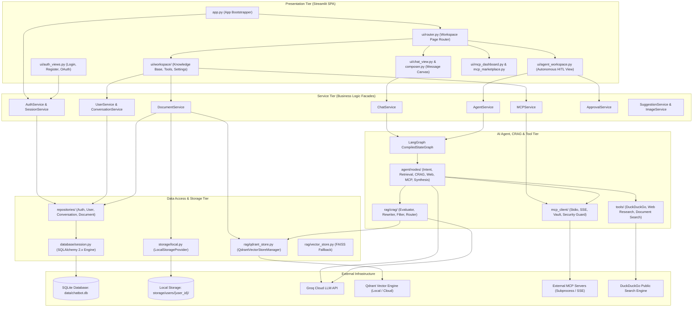
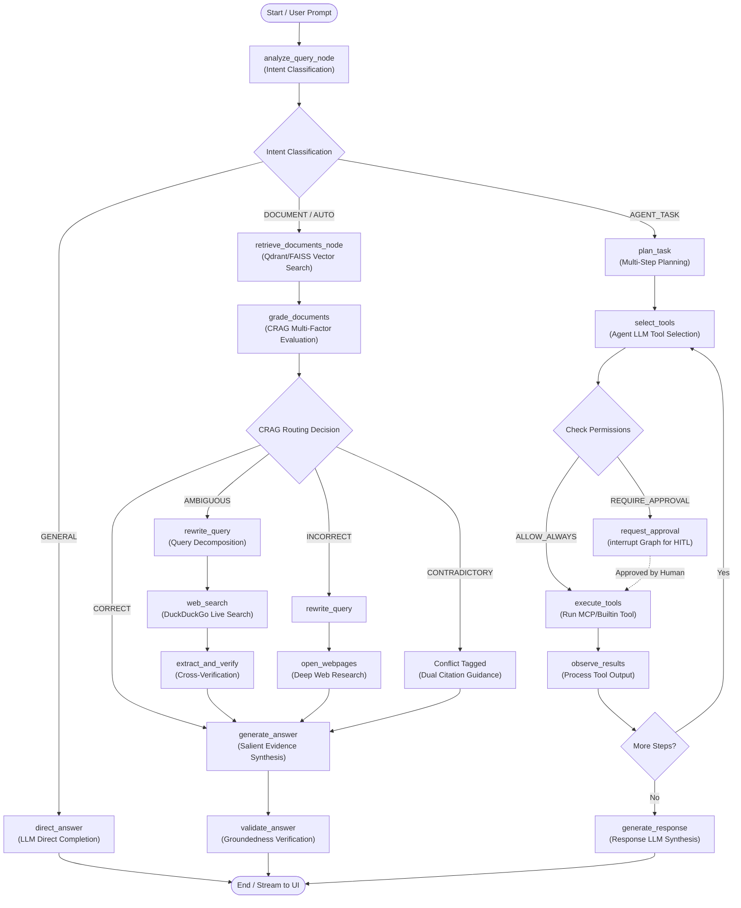

# QnAGPT Technical Architecture Specification

**Project**: QnAGPT – Production-Ready Multi-User Agentic AI Workspace  
**Status**: Production Architecture (Post-Restructuring v2.0.0-modular)  
**Author**: Principal Software Architect & Senior Python Backend Engineer  

---

## 1. System Overview & Core Principles

**QnAGPT** is an enterprise-oriented, multi-tenant Agentic AI workspace and multimodal Q&A chatbot built with **Python 3.12+**, **Streamlit**, **LangChain**, **LangGraph**, **Groq Cloud LLMs**, **Qdrant / FAISS**, **SQLAlchemy 2.x / SQLite**, and the **Model Context Protocol (MCP)**.

### Architectural Principles
1. **Tenant Isolation**: Every database query, vector search payload, file storage path, and MCP tool configuration is strictly scoped by `user_id`. Cross-tenant data leakage is structurally impossible.
2. **Separation of Concerns**: Strict tier boundaries prevent presentation code (`streamlit`) from leaking into domain agent nodes, services, or data access layers.
3. **Decoupled Execution Models**: Unbound Response LLM synthesis is cleanly separated from bound Agent tool execution, preventing LLM tool-calling hallucinations (such as accidental Harmony `browser.open` or malformed JSON tool calls).
4. **Corrective RAG (CRAG)**: Retrieval does not naively trust vector similarity. Every chunk is graded across relevance, coverage, and contradiction dimensions. High-confidence evidence is filtered to salient sentences; ambiguous queries trigger semantic rewrite and live web research; contradictory evidence is highlighted explicitly.
5. **Human-in-the-Loop (HITL) Safety**: Dangerous actions categorized as `MODIFICATION` or `SENSITIVE` interrupt LangGraph execution, requiring a cryptographic single-use approval token verified by the backend before execution can resume.

---

## 2. High-Level Architectural Diagram

---

## 3. Subsystem Breakdown

### 3.1. LangGraph State Machine Subsystem (`qna_bot/agent/`)

The core execution engine is a compiled `StateGraph` in [qna_bot/agent/graph.py](file:///c:/Users/alind/OneDrive/Desktop/VS%20CODE/Langchain/langchain_01/qna_bot/agent/graph.py) comprising 21 nodes and conditional routing:

#### Node Suite Modularization (`qna_bot/agent/nodes/`):
- `base.py`: Shared base class `BaseNodeSuite`, LLM factories, context formatters, and dynamic mock resolution for tests.
- `intent.py`: `IntentNodesMixin` holding `analyze_query` and `rewrite_query`.
- `retrieval.py`: `RetrievalNodesMixin` holding `retrieve_documents`.
- `crag.py`: `CRAGNodesMixin` holding `grade_documents` with full CRAG evaluation.
- `web.py`: `WebNodesMixin` holding `web_search`, `refine_web_search`, `open_webpages`, `extract_and_verify`.
- `mcp_exec.py`: `MCPNodesMixin` holding `discover_tools`, `plan_task`, `select_tools`, `check_permissions`, `request_approval`, `_run_single_tool_call`, `execute_tools`, `observe_results`, `evaluate_progress`.
- `synthesis.py`: `SynthesisNodesMixin` holding `generate_answer`, `direct_answer`, `validate_answer`, `generate_response`.
- `__init__.py`: Composes `AgentNodeSuite` inheriting all mixins and re-exports all public interfaces.

---

### 3.2. Corrective RAG (CRAG) Subsystem (`qna_bot/rag/crag/`)

The CRAG subsystem implements a rigorous multi-stage verification pipeline:

1. **`DocumentEvaluator` (`evaluator.py`)**: Grades retrieved chunks across 5 dimensions:
   - Relevance (semantic overlap with query intent)
   - Coverage (fraction of required information answered)
   - Factual sufficiency (completeness without speculation)
   - Contradiction detection (presence of incompatible statements)
   - Temporal validity (currency of information)
2. **`CRAGRouter` (`routing.py`)**: Computes confidence and maps results into deterministic routes:
   - **`CORRECT` (Confidence $\ge 0.70$)**: Evidence is sufficient. Filter chunks to salient evidence sentences and synthesize answers.
   - **`AMBIGUOUS` ($0.40 \le \text{Confidence} < 0.70$)**: Resolves conversational anaphora and query drift via `QueryRewriter`, searches DuckDuckGo, and cross-verifies findings.
   - **`INCORRECT` (Confidence $< 0.40$)**: Triggers full web research fallback via `SafeWebPageReader` and table extractors.
   - **`CONTRADICTORY`**: Incompatible evidence across sources triggers balanced perspective framing with explicit source citations.
3. **`DocumentFilter` (`document_filter.py`)**: Sentence-level evidence extraction using regex tokenizers and Jaccard similarity deduplication.
4. **`EvidenceAssembler` (`evidence.py`)**: Assembles verified sentences into an `EvidenceBundle` tracking sources, chunk offsets, and contradiction alerts.
5. **`CRAGMetricsTracker` (`metrics.py`)**: Thread-safe in-memory metrics tracker recording grade distributions, rewrites, web fallbacks, and latencies.

---

### 3.3. Model Context Protocol (MCP) Subsystem (`qna_bot/mcp_client/`)

Implements the official Model Context Protocol 2024 specification:
- **Stdio Transport**: Spawns isolated local subprocesses with strict executable whitelisting, command-line argument validation, and shell metacharacter blocking (`;`, `&`, `|`, `` ` ``, `$`).
- **Streamable HTTP & SSE Transport**: Asynchronous Server-Sent Events stream reader with Server-Side Request Forgery (SSRF) protection blocking private IP ranges (`127.0.0.0/8`, `10.0.0.0/8`, `172.16.0.0/12`, `192.168.0.0/16`, `169.254.0.0/16`).
- **Encrypted Credential Vault (`credentials.py`)**: Encrypts third-party API keys and OAuth tokens using Fernet (AES-128-CBC + HMAC-SHA256) stored in `data/.mcp_vault.key`.
- **Registry Integration (`registry/`)**: Live directory querying against `registry.modelcontextprotocol.io` and `glama.ai/api/mcp/v1` with caching.
- **Human-in-the-Loop (HITL) Gatekeeper**: Tools with `MODIFICATION` or `SENSITIVE` categories pause LangGraph execution and generate single-use cryptographic tokens.

---

### 3.4. Persistence Architecture

Physical storage resides in a single SQLite database file (`data/chatbot.db`):
- **Engine**: SQLAlchemy 2.x `Engine` configured with:
  - `PRAGMA foreign_keys = ON;`
  - `PRAGMA journal_mode = WAL;` (Write-Ahead Logging for concurrent readers/writer)
  - `PRAGMA busy_timeout = 10000;` (10-second wait to prevent locking errors)
  - `PRAGMA synchronous = NORMAL;`
- **Schema Evolution**: Managed via Alembic migrations (`migrations/versions/0001_initial_platform_schema.py`) and guarded dynamically at startup by `ensure_legacy_workspace_synced` in `qna_bot/database/legacy_migration.py`.
- **Checkpointing**: Stateful graph session states are saved via `SqliteSaver` in `qna_bot/agent/memory.py`.

---

## 4. Layer Invariance & Dependency Matrix

| Layer | Can Import From | Cannot Import From |
| :--- | :--- | :--- |
| **Presentation Tier (`ui/`)** | `services/`, `schemas/`, `config/`, `core/` | `database/`, `repositories/`, `models/` (Direct DB access strictly forbidden) |
| **Service Tier (`services/`)** | `repositories/`, `models/`, `schemas/`, `storage/`, `agent/`, `rag/`, `mcp_client/`, `config/`, `core/` | `ui/`, `app.py` |
| **Agent / RAG Tier (`agent/`, `rag/`)** | `tools/`, `mcp_client/`, `schemas/`, `config/`, `core/` | `ui/`, `app.py` |
| **Data Access Tier (`repositories/`)** | `database/`, `models/`, `schemas/`, `core/` | `services/`, `ui/`, `agent/` |
| **Platform Primitives (`core/`)** | Python Standard Library | Any application module (Zero internal dependencies) |
