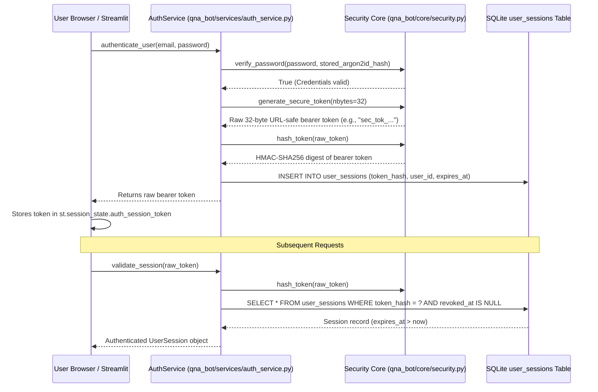
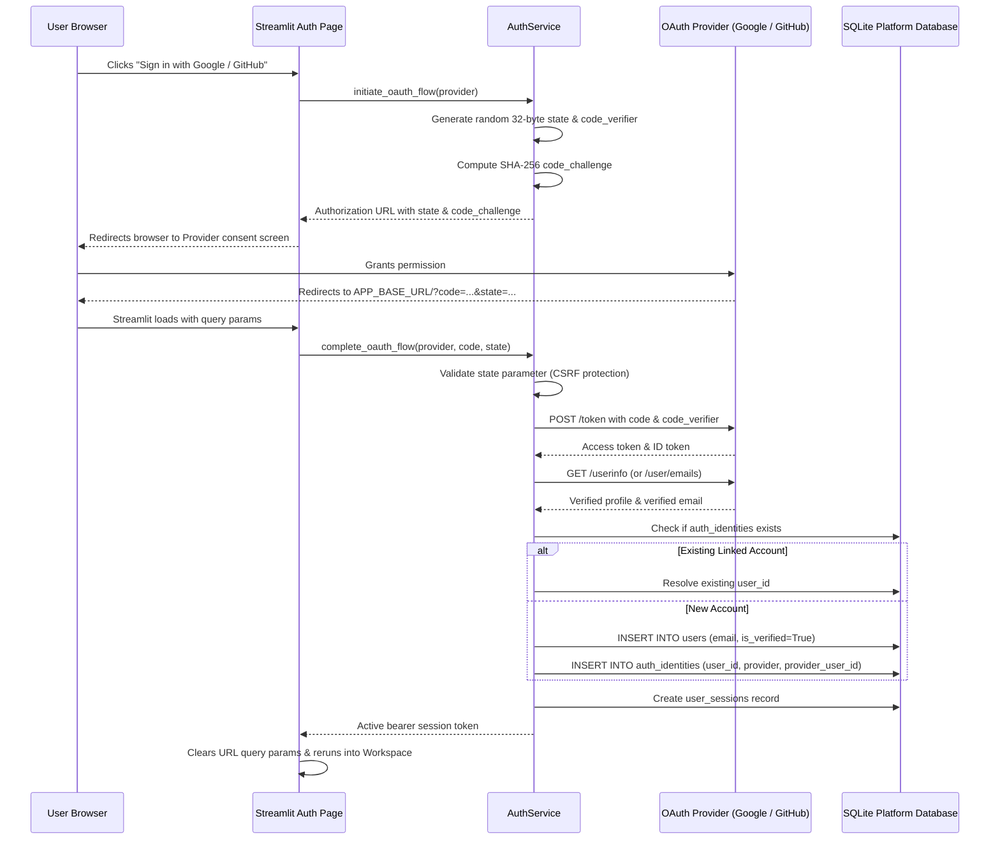

# QnAGPT Authentication & Session Flow Specification

**Project**: QnAGPT – Production-Ready Multi-User Agentic AI Workspace  
**Status**: Verified Implementation  
**Author**: Principal Software Architect & Senior Python Backend Engineer  

---

## 1. Supported Identity Providers

1. **Email & Password**:
   - Normalized email formatting: `email.strip().lower()`.
   - Minimum password length: $\ge 8$ characters with lowercase, uppercase, and numeric/symbol diversity.
   - Cryptographic hashing via `argon2-cffi` (`Argon2id` algorithm with unique per-password cryptographic salt).
   - Constant-time hash verification preventing timing-attack vectors.
   - Generic authentication failure response (`"Invalid email or password"`) preventing user enumeration.
2. **Google Sign-In**:
   - OAuth 2.0 / OIDC using `Authlib` with `GOOGLE_CLIENT_ID` and `GOOGLE_CLIENT_SECRET`.
   - Automatic account linking only when `email_verified == true`.
3. **GitHub Sign-In**:
   - OAuth 2.0 using `Authlib` with `GITHUB_CLIENT_ID` and `GITHUB_CLIENT_SECRET`.
   - Fetches verified primary email via GitHub API (`https://api.github.com/user/emails`).

*Note*: If OAuth credentials are not provided in `.env`, the UI renders a helpful notification banner and keeps standard Email/Password authentication fully functional.

---

## 2. Sliding-Window Rate Limiting

To prevent credential stuffing and brute-force attacks, the application implements `SlidingWindowRateLimiter` (`qna_bot/services/auth_service.py`):

```python
class SlidingWindowRateLimiter:
    def __init__(self, max_attempts: int = 5, window_seconds: int = 300):
        self.max_attempts = max_attempts
        self.window_seconds = window_seconds
```

- **Policy**: Maximum of **5 failed attempts** within a **300-second (5-minute)** sliding window per client identifier (email or IP address).
- **Enforcement**: If the attempt count exceeds 5, `AuthService` raises `RateLimitExceededError` with an exact countdown of remaining retry seconds.
- **Reset**: Successful authentication immediately clears the failure record for that identifier.

---

## 3. Session Token Lifecycle



### Security Properties:
- **No Plaintext Session Storage**: Only HMAC-SHA256 digests are persisted in SQLite. A compromised database snapshot cannot be used to hijack active user sessions.
- **Configurable TTL**: Sessions expire after `settings.session_ttl_hours` (default: 168 hours / 7 days).
- **Explicit Revocation**: Logging out marks `revoked_at = CURRENT_TIMESTAMP`, immediately invalidating the session digest across all devices.

---

## 4. OAuth2 Authorization Handshake with PKCE

Complies with RFC 7636 Proof Key for Code Exchange (PKCE) to prevent code interception attacks:


