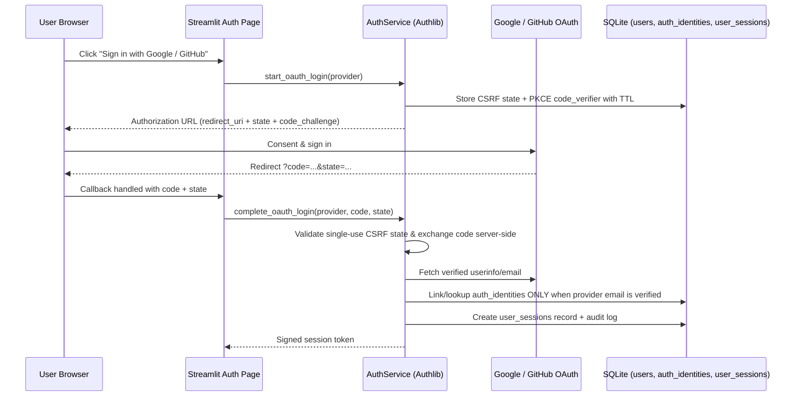

# QnAGPT Authentication & Session Flow

## 1. Supported Identity Providers

1. **Email & Password** (`Argon2id` via `argon2-cffi`, fallback verification support strictly unnecessary for new passwords since `argon2-cffi` is installed).
2. **Google Sign-In** (Authlib OAuth 2.0 / OIDC using `GOOGLE_CLIENT_ID` & `GOOGLE_CLIENT_SECRET`).
3. **GitHub Sign-In** (Authlib OAuth 2.0 using `GITHUB_CLIENT_ID` & `GITHUB_CLIENT_SECRET`).

When OAuth provider env variables are absent, the login page displays an informative configuration notice and keeps Email/Password registration & login fully functional (zero fake OAuth logins).

## 2. Password & Registration Rules

- Minimum length `>= 8` characters, requiring uppercase, lowercase, numeric/symbol diversity, trimmed email normalization (`email.strip().lower()`).
- Hashed with `argon2.PasswordHasher()` (Argon2id with unique per-password cryptographic salt); plaintext passwords are never logged or stored.
- Generic authentication failure message (`"Invalid email or password"`) prevents user enumeration.
- In-memory/SQLite sliding-window login rate limiting (`max 5 failed attempts per 5 minutes` per normalized email/client key).

## 3. OAuth2 Sequence Diagram (Authlib)

## 4. Account Linking & Ownership Protection

- OAuth identity linking to an existing password user ONLY occurs if the OAuth provider asserts `email_verified = true` (or after an authenticated user explicitly connects a second provider from the Account page).
- Every protected service method resolves `user_id` by validating the active `session_token` (`HMAC-SHA256` hash lookup against `user_sessions`, verifying `revoked_at IS NULL` and `expires_at > now`).
- Logout immediately sets `user_sessions.revoked_at = now` and clears browser session state.
- Account deletion cascades or tombstones sessions, documents, vector embeddings (`Qdrant` delete filter on `user_id`), local storage files (`storage/users/{user_id}/`), conversations, and MCP credentials.
