# QnAGPT Database Design & Persistence Architecture

**Project**: QnAGPT – Production-Ready Multi-User Agentic AI Workspace  
**Status**: Verified Relational Schema & ORM Mapping  
**Author**: Principal Software Architect & Senior Python Backend Engineer  

---

## 1. Relational Engine & Connection Pragma Standards

The platform persists all relational data in a single SQLite database file (`data/chatbot.db`) managed via **SQLAlchemy 2.x** and **Alembic**.

Every SQLite connection acquired by `SQLAlchemyDatabase` (`qna_bot/database/session.py`) automatically enforces the following production PRAGMAs:

```sql
PRAGMA foreign_keys = ON;       -- Mandatory cascading deletes and referential integrity
PRAGMA journal_mode = WAL;      -- Write-Ahead Logging for concurrent readers and writers
PRAGMA busy_timeout = 10000;    -- 10-second wait before raising "database is locked" errors
PRAGMA synchronous = NORMAL;    -- Maximizes write throughput while preserving WAL crash-safety
```

---

## 2. Entity Relationship Diagram (ERD)

```mermaid
erDiagram
    users ||--o{ auth_identities : "links"
    users ||--o{ user_sessions : "owns"
    users ||--o{ conversations : "owns"
    users ||--o{ uploaded_documents : "uploads"
    users ||--o{ mcp_servers : "configures"
    users ||--o{ user_settings : "stores"
    users ||--o{ audit_logs : "generates"

    conversations ||--o{ messages : "contains"
    conversations ||--o{ conversation_feedback : "rates"
    uploaded_documents ||--o{ document_chunks : "segments"
    mcp_servers ||--o{ mcp_tool_permissions : "governs"
    mcp_servers ||--o{ mcp_credentials : "secures"

    users {
        string id PK "uuid4 string"
        string email UK "normalized lowercase email"
        string password_hash "Argon2id cryptographic hash"
        string full_name "User display name"
        string avatar_url "Profile avatar URL"
        boolean is_active "Account status"
        boolean is_verified "Email verification flag"
        datetime created_at "Account creation UTC"
        datetime updated_at "Profile mutation UTC"
        datetime last_login_at "Last session UTC"
    }

    auth_identities {
        string id PK "uuid4 string"
        string user_id FK "FK -> users.id (CASCADE)"
        string provider "google | github"
        string provider_user_id "External provider subject ID"
        string provider_email "Verified provider email"
        datetime created_at "Link UTC"
    }

    user_sessions {
        string id PK "uuid4 string"
        string user_id FK "FK -> users.id (CASCADE)"
        string token_hash UK "HMAC-SHA256 digest of bearer token"
        string csrf_token "CSRF protection token"
        datetime expires_at "Session TTL expiration UTC"
        datetime revoked_at "Explicit logout timestamp"
        datetime created_at "Session creation UTC"
    }

    conversations {
        string id PK "uuid4 string (conversation_id)"
        string user_id FK "FK -> users.id (CASCADE)"
        string title "Conversation title"
        string description "Optional conversation note"
        string model_name "Default LLM text model"
        string agent_mode "Auto | Document | General | Agent"
        string status "active | archived"
        boolean is_pinned "Pinned to top of sidebar"
        datetime created_at "Creation UTC"
        datetime updated_at "Last turn UTC"
        datetime archived_at "Archived UTC"
    }

    messages {
        int id PK "Autoincrement sequence ID"
        string conversation_id FK "FK -> conversations.id (CASCADE)"
        string user_id FK "FK -> users.id (CASCADE)"
        string role "user | assistant | system | tool"
        string content "Message text content"
        string model_name "Model used to generate message"
        string tool_call_id "Tool call identifier"
        json metadata_json "Citations, token usage, tool metrics"
        datetime created_at "Creation UTC"
    }

    uploaded_documents {
        string id PK "uuid4 string (document_id)"
        string user_id FK "FK -> users.id (CASCADE)"
        string filename "Original uploaded filename"
        string file_type "pdf | txt | docx | csv | md"
        int file_size_bytes "Size on disk in bytes"
        string file_hash "SHA-256 digest for deduplication"
        string storage_path "Local filesystem storage path"
        string processing_status "pending | indexed | failed"
        int chunk_count "Number of indexed chunks"
        int page_count "Page count if PDF/DOCX"
        string error_message "Failure explanation if failed"
        datetime created_at "Upload UTC"
        datetime updated_at "Last indexed UTC"
    }

    document_chunks {
        string id PK "uuid4 string"
        string document_id FK "FK -> uploaded_documents.id (CASCADE)"
        int chunk_index "Sequential chunk index"
        string chunk_text "Extracted text content"
        int token_count "Token count of chunk"
        string point_id "Qdrant vector point UUID"
        datetime created_at "Indexing UTC"
    }

    mcp_servers {
        string id PK "uuid4 string (server_id)"
        string user_id FK "FK -> users.id (CASCADE)"
        string name "Unique server display name"
        string transport_type "stdio | sse | streamable_http"
        string command "Executable command if stdio"
        json args_json "Command line arguments list"
        json env_json "Non-sensitive environment variables"
        string url "Remote endpoint URL if SSE"
        string status "connected | stopped | error"
        boolean is_enabled "Server active toggle"
        datetime created_at "Registration UTC"
        datetime updated_at "Last modified UTC"
    }

    mcp_tool_permissions {
        string id PK "uuid4 string"
        string user_id FK "FK -> users.id (CASCADE)"
        string server_id FK "FK -> mcp_servers.id (CASCADE)"
        string tool_name "Original tool name"
        string permission_category "READ_ONLY | MODIFICATION | SENSITIVE | BLOCKED"
        boolean auto_approve "Skip HITL approval prompt"
        boolean enabled "Tool enabled toggle"
        datetime updated_at "Last updated UTC"
    }

    mcp_credentials {
        string id PK "uuid4 string"
        string user_id FK "FK -> users.id (CASCADE)"
        string server_id FK "FK -> mcp_servers.id (CASCADE)"
        string credential_type "api_key | oauth_token | bearer"
        blob encrypted_value "Fernet AES-128-CBC encrypted ciphertext"
        datetime updated_at "Last rotated UTC"
    }

    audit_logs {
        string id PK "uuid4 string"
        string execution_id "Trace execution identifier"
        string user_id FK "FK -> users.id (CASCADE)"
        string thread_id "Active conversation ID"
        string server_id "MCP server identifier"
        string server_name "MCP server display name"
        string tool_name "Executed tool name"
        string status "completed | failed | blocked | rejected | awaiting_approval"
        string masked_arguments "Arguments with secrets redacted"
        string result_summary "Output snippet"
        float duration_ms "Execution latency in ms"
        datetime created_at "Logged UTC"
    }
```



---

## 3. Dynamic Schema Compatibility Bridge

To eliminate runtime `OperationalError` when running across environments with differing migration baselines, `ensure_legacy_workspace_synced` (`qna_bot/database/legacy_migration.py`) inspects SQLite tables at application startup using:

```sql
PRAGMA table_info(threads);
PRAGMA table_info(conversations);
```

If modern columns such as `is_pinned` or `description` are absent from older database files, it executes safe non-destructive `ALTER TABLE` statements:

```sql
ALTER TABLE threads ADD COLUMN is_pinned INTEGER DEFAULT 0;
```

This guarantees seamless zero-downtime upgrades when pulling new application code without requiring manual terminal migrations.

---

## 4. Indexing Strategy

To maintain sub-millisecond query performance on SQLite:

1. **`users(email)`**: Unique index for instant authentication lookups.
2. **`user_sessions(token_hash)`**: Unique index for bearer token validation.
3. **`conversations(user_id, updated_at DESC)`**: Composite index powering time-bucketed sidebar history.
4. **`messages(conversation_id, created_at ASC)`**: Composite index powering instant conversation loading.
5. **`uploaded_documents(user_id, file_hash)`**: Composite index for instant duplicate detection during uploads.
6. **`mcp_tool_permissions(user_id, server_id, tool_name)`**: Composite index for instant pre-execution permission resolution.
