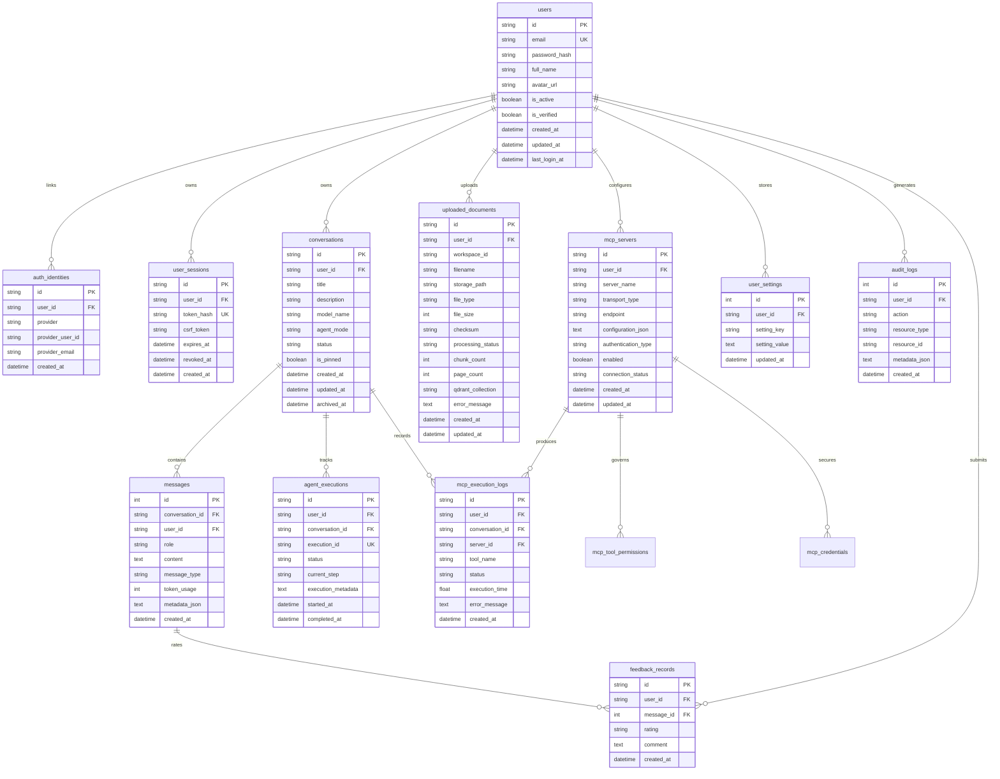

# QnAGPT Database Schema (SQLite + SQLAlchemy 2.x + Alembic)

## 1. Engine Configuration

- Foreign keys enforced on every SQLite connection: `PRAGMA foreign_keys = ON`.
- Concurrency & durability: `PRAGMA journal_mode = WAL`, `PRAGMA busy_timeout = 10000`, `PRAGMA synchronous = NORMAL`.
- Managed via Alembic migrations in `migrations/`.

## 2. Entity Relationship Diagram

## 3. Core Indexes & Constraints

- `users`: unique index on lower(`email`).
- `auth_identities`: unique composite constraint `(provider, provider_user_id)` and index on `user_id`.
- `user_sessions`: unique index on `token_hash`, index on `(user_id, expires_at)`.
- `conversations`: composite index `(user_id, status, is_pinned, updated_at)`.
- `messages`: composite index `(conversation_id, user_id, created_at)`.
- `uploaded_documents`: composite index `(user_id, checksum)` for fast per-user deduplication + `(user_id, workspace_id, processing_status)`.
- `mcp_servers`: unique `(user_id, server_name)` + index `(user_id, enabled)`.
- `mcp_tool_permissions`: PK / unique `(user_id, server_id, tool_name)`.
- `mcp_credentials`: unique `(user_id, server_id, auth_type)` storing only Fernet ciphertexts.
- `user_settings`: unique `(user_id, setting_key)`.
- `audit_logs`, `agent_executions`, `mcp_execution_logs`: indexes on `(user_id, created_at DESC)` and `conversation_id`.

## 4. Legacy Migration Bridge (`chatbot.db` -> Normalized Schema)

Existing `data/chatbot.db` data (`threads`, `thread_messages`, `mcp_servers`, `mcp_credentials`, `mcp_tool_permissions`, `mcp_approvals`, `mcp_audit_logs`) belongs to legacy workspace `local_user`. During Alembic + migration execution:
- Legacy tables stay intact/backed up first (`storage/backups/`).
- A seeded legacy/local workspace user record receives existing threads, messages, MCP registrations, and encrypted credentials cleanly without changing `(user_id, server_id)` vault keys or breaking LangGraph checkpoints.
