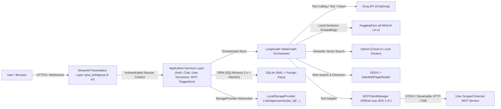

# QnAGPT High-Level Design (HLD)

## 1. System Context

QnAGPT is a multi-user Agentic AI, Retrieval-Augmented Generation (RAG), Deep Web Research, and Model Context Protocol (MCP) workspace built on Python 3.12+ and Streamlit (`1.65.0`).

## 2. Core Component Architecture

1. **Presentation Layer (`qna_bot/ui/`)**:
   - Unified light-only SaaS shell (`styles.css`, `design_system.py`, `st.html()` rendering).
   - Authentication gate (Login, Register, Google/GitHub OAuth callbacks, Account settings).
   - Responsive collapsible sidebar + mobile drawer + grouped conversation history.
   - Workspace pages: `Chat`, `Agent Workspace`, `Knowledge Base`, `MCP Marketplace`, `MCP Servers`, `Tool Marketplace`, `Account`, `Settings`.
2. **Application & Domain Services (`qna_bot/services/`)**:
   - Enforce server-side authorization and strict `user_id` ownership before invoking data or MCP operations.
   - `AuthService`, `UserService`, `ConversationService`, `MessageService`, `DocumentService`, `StorageService`, `QdrantVectorStoreService`, `MCPService`, `ApprovalService`, `SuggestionService`, `ChatService`.
3. **Orchestration & Integrations (`qna_bot/agent/`, `qna_bot/mcp/`, `qna_bot/rag/`, `qna_bot/tools/`)**:
   - LangGraph `StateGraph` with persistent SQLite checkpointer (`langgraph-checkpoint-sqlite`), conditional routing, HITL `interrupt()` / `Command(resume=...)`, clean Agent LLM vs Response LLM separation, and deep web page extraction/verification.
   - Standalone `MCPClientManager` completely decoupled from LangGraph via `qna_bot/agent/mcp_adapter.py`.
4. **Data & Storage Layer**:
   - **SQLite** via SQLAlchemy 2.x + Alembic (`WAL` mode, `PRAGMA foreign_keys=ON`, busy timeout).
   - **Qdrant** (`qdrant-client`) via `VectorStoreBackend` supporting both `QDRANT_MODE=cloud` (`QDRANT_URL` + `QDRANT_API_KEY`) and `QDRANT_MODE=local` (`http://localhost:6333`).
   - **LocalStorageProvider** (`./storage/users/{user_id}/{documents,images,attachments,exports}`) behind a swappable `StorageProvider` ABC (zero AWS S3 dependency).

## 3. Data-Flow Overview

### 3.1 Authentication Flow
User authenticates via Argon2id email/password or Authlib OAuth2 (Google / GitHub) -> backend verifies credentials or OAuth state/nonce -> creates signed session token + persistent SQLite `user_sessions` row -> UI resolves authenticated `user_id` exclusively from verified backend session state.

### 3.2 Chat & LangGraph Lifecycle
User submits prompt + attachments -> attachments validated & saved via `LocalStorageProvider` -> `ChatService` persists user message to SQLite -> LangGraph `StateGraph` routes between Direct Response, RAG (`Qdrant` filtered by `user_id`), Web Research (`web_search -> open_webpages -> extract_and_verify`), or Agentic MCP execution (with backend HITL approval for write/sensitive calls) -> Response LLM synthesizes final answer -> assistant message + citations + execution metadata persisted in SQLite.

### 3.3 Document Ingestion Flow
Upload -> Extension/MIME/size validation -> Path-safe save via `LocalStorageProvider` -> Extract text (`PDF`, `TXT`, `DOCX`, `CSV`, `MD`) -> Clean & chunk text -> Embed locally with `all-MiniLM-L6-v2` -> Upsert points into Qdrant with mandatory `user_id`, `workspace_id`, `document_id`, `source`, `chunk_index` payload -> Persist status (`uploaded` -> `processing` -> `indexed` | `failed`) in `uploaded_documents` SQLite table. Original files remain preserved even if Qdrant indexing fails so retries succeed without re-uploading.

## 4. Security Boundaries

- **Identity Trust Boundary**: Frontend never supplies trusted `user_id`; backend session verification injects `user_id` into repositories, storage paths, Qdrant filters, MCP namespaces, and HITL approvals.
- **Credential Isolation Boundary**: Fernet AES-128-CBC + HMAC-SHA256 encrypts OAuth tokens, MCP bearer tokens, and API keys at rest in SQLite; raw secrets never appear in logs or UI.
- **Network & Execution Boundary**: Strict HTTPS + DNS private-IP SSRF checks on remote MCP URLs and webpage extraction (`SafeWebPageReader`), allowlisted STDIO executables, and backend HITL approval enforcement.
