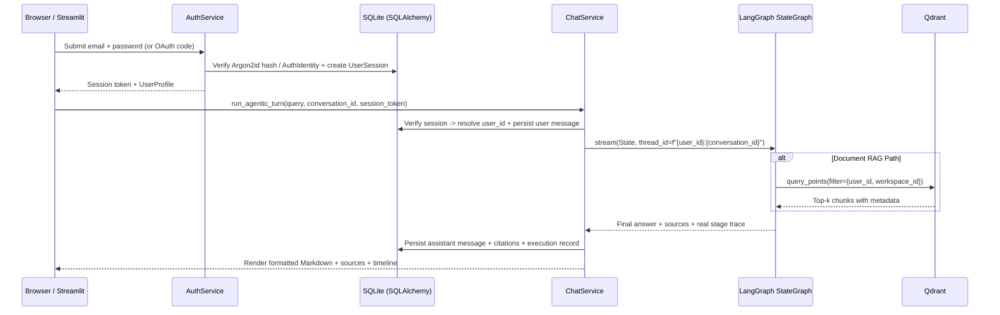

# QnAGPT Low-Level Design (LLD)

## 1. Module & Layer Responsibilities

| Layer | Directory | Responsibility |
|---|---|---|
| Entry & Shell | `qna_bot/app.py`, `qna_bot/cli.py` | Page config, auth session verification, service container wiring, page dispatch |
| Core & Config | `qna_bot/core/`, `qna_bot/config/` | `AppSettings` env validation, SQLAlchemy engine/session factory, logging (secret masking), security utilities, typed exceptions |
| ORM Models | `qna_bot/models/` | SQLAlchemy 2.x declarative models with foreign keys, cascade/retention behavior, and composite indexes |
| Validation Schemas | `qna_bot/schemas/` | Pydantic v2 DTOs for auth requests, conversation mutations, document uploads, and MCP configs |
| Repositories | `qna_bot/repositories/` | Transactional SQLAlchemy 2.x queries strictly enforcing `WHERE user_id = :auth_user_id` ownership checks |
| Services | `qna_bot/services/` | Domain orchestration, rate limiting, password policy, storage-to-Qdrant coordination, LangGraph turn execution, suggestions |
| Storage Abstraction | `qna_bot/storage/` | `StorageProvider` ABC and `LocalStorageProvider` enforcing sanitized keys and path-traversal containment |
| Vector Store | `qna_bot/rag/` | `VectorStoreBackend` ABC, `QdrantVectorStoreManager`, `FAISSVectorStoreManager` (legacy migration bridge), loaders, splitter, embeddings, grader, retriever |
| Agent & LangGraph | `qna_bot/agent/` | `AgentState`, `StateGraph` assembly, Agent vs Response LLM helpers, `SqliteSaver`, HITL `ApprovalManager`, MCP tool adapter |
| MCP Host & Client | `qna_bot/mcp/` | SDK transport sessions (`stdio`, `streamable_http`, `sse`), Fernet vault, OAuth PKCE, Official & Glama registry discovery |
| Web Research | `qna_bot/tools/` | Multi-backend `DuckDuckGoWebSearcher`, SSRF-safe `SafeWebPageReader` (BeautifulSoup4/lxml), structured extraction, cross-source verification |
| Presentation | `qna_bot/ui/` | Centralized Light design system (`render_html`), collapsible sidebar, chat & composer, execution timeline, workspace subpages |

## 2. Repository & Service Contracts

- All repositories accept an explicit `user_id` resolved from verified backend `AuthSession` (never raw UI input).
- Updates/deletes verify `(resource_id, user_id)` ownership atomically inside SQLAlchemy transactions and raise `AuthorizationError` / `MemoryPersistenceError` on mismatch.
- `StorageService` wraps `LocalStorageProvider`: resolves `storage/users/{safe_user_id}/{bucket}/{uuid}_{safe_filename}`, checks canonical `Path.resolve().is_relative_to(...)`, validates SHA-256 checksums, and refuses execution permissions.
- `QdrantVectorStoreManager` enforces a mandatory `models.Filter(must=[FieldCondition(key="user_id", match=MatchValue(value=user_id)), ...])` on every `query_points`, `scroll`, and `delete` operation.

## 3. Authentication & Chat Sequence

## 4. Error Handling & Recovery Strategy

1. **Qdrant Temporarily Unavailable**: Original uploaded file stays persisted in `LocalStorageProvider` and `uploaded_documents.processing_status = "failed"` with error message; user can click **Re-index** without re-uploading.
2. **Groq `tool_use_failed`**: Agent LLM binds tools with `tool_choice="auto"` and remaps accidental Harmony `browser.open` -> `open_web_page`; unbound Response LLM strips raw `tool_calls` from history and automatically retries once on Harmony leakage.
3. **Database Contention**: SQLite configured with `WAL` journal mode, `busy_timeout=10000`, `synchronous=NORMAL`, and short-lived transaction contexts per repository call.
4. **MCP Timeout or Transport Drop**: Configurable per-session timeouts (`connect=15s`, `tool=60s`), `ExceptionGroup` unwrapping, status updates (`error` vs `connected`), and graceful fallback in LangGraph.
