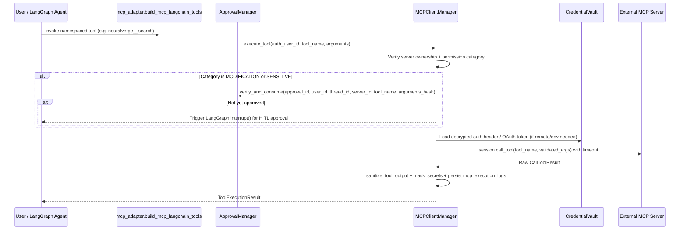

# QnAGPT Model Context Protocol (MCP) Architecture

## 1. Decoupling Principle

The MCP subsystem (`qna_bot/mcp/`) is a standalone Python host library wrapping the official PyPI `mcp` SDK (`>=2.3.0`). LangGraph never owns or imports MCP session internals directly; instead `qna_bot/agent/mcp_adapter.py` converts authorized user MCP tools (`DiscoveredTool`) into LangChain `StructuredTool` instances using dynamically constructed Pydantic v2 argument schemas (`build_pydantic_args_schema`).

> **Import Path Guard**: `qna_bot.sanitize_import_path()` strips the inner `qna_bot/` package directory from `sys.path` when launched via `streamlit run qna_bot/app.py`, preventing `qna_bot/mcp/` from shadowing the third-party PyPI `mcp` package.

---

## 2. Core Components

| Module | Class / Functions | Responsibility |
|---|---|---|
| `qna_bot/mcp/client_manager.py` | `MCPClientManager` | Thread-safe per-user lifecycle, tool/resource/prompt discovery, health checks, and audited execution |
| `qna_bot/mcp/connection.py` | `AsyncLoopRunner`, `MCPConnectionHandle`, `resolve_auth_headers` | Dedicated background asyncio loop preserving AnyIO cancel scopes across Streamlit reruns; opens `stdio`, `streamable_http`, and `sse` transports |
| `qna_bot/mcp/credentials.py` | `CredentialVault`, `EncryptedSQLiteTokenStorage` | Fernet (`AES-128-CBC` + `HMAC-SHA256`) at-rest encryption scoped strictly by `(user_id, server_id, auth_type)` |
| `qna_bot/mcp/oauth.py` | `OAuthFlowManager`, `PendingOAuthSession` | RFC 7636 OAuth 2.1 + PKCE metadata discovery, single-use CSRF state binding, token exchange, refresh, and revocation |
| `qna_bot/mcp/security.py` | `validate_stdio_config`, `validate_remote_url`, `mask_secrets`, `sanitize_tool_output`, `build_stdio_spec_from_package` | Executable allowlist, shell-metacharacter rejection, SSRF private-IP/DNS guards, secret masking |
| `qna_bot/mcp/permissions.py` | `infer_permission_category`, `resolve_tool_policy` | Categorizes tools into `READ_ONLY`, `MODIFICATION`, `SENSITIVE`, or `BLOCKED` |
| `qna_bot/agent/approval.py` | `ApprovalManager`, `compute_arguments_hash` | Persists exact SHA-256 `(user_id, thread_id, server_id, tool_name, arguments_hash)` approvals and consumes once |
| `qna_bot/mcp/registry/service.py` | `MCPRegistryService` | Discovers, caches (`SQLite`), and merges connectors from Official MCP Registry & Glama |
| `qna_bot/agent/mcp_adapter.py` | `build_mcp_langchain_tools`, `validate_tool_arguments` | Exposes enabled, non-`BLOCKED` tools under deterministic namespaced names to LangGraph |

---

## 3. Transport Support & Timeout Management

- **STDIO (`stdio_client`)**: Allowlisted executables only (`python`, `python3`, `uv`, `uvx`, `node`, `npx`, `docker`); blocks shell metacharacters (`;|&`\`$><\r\n`); strips parent API keys (`BLOCKED_PARENT_ENV_KEYS`); enforces `allowed_roots` directory containment.
- **Streamable HTTP (`streamable_http_client`)**: Unpacks the 3-tuple / 2-tuple session return forms cleanly, attaches Fernet-decrypted headers or OAuth SDK `OAuthClientProvider`, and configures `httpx2.Timeout(connect_timeout, read=max(90.0, tool_timeout + 15.0))`. Default connect timeout `15s`, default tool timeout `60s`.
- **Server-Sent Events (`sse_client`)**: Supported for legacy remote MCP servers with identical SSRF and auth-header resolution.
- **Error Formatting**: `_format_exception_detail` recursively unwraps AnyIO/Python `BaseExceptionGroup` leaves so UI error banners display concrete root causes rather than opaque `"unhandled errors in a TaskGroup (1 sub-exception)"` messages.

---

## 4. Multi-User Security & Tool Execution Pipeline

---

## 5. Multi-User Evolution Constraints (Target Platform)

- **User Ownership**: `mcp_servers`, `mcp_credentials`, `mcp_tool_permissions`, `mcp_approvals`, and `mcp_execution_logs` enforce foreign keys (`user_id -> users.id`) and transactionally verify ownership on every connect, toggle, credential update, or tool call.
- **Groq Tool Binding Budget**: LangGraph `select_tools` caps dynamically bound MCP tools per turn (`max 35`) and sanitizes/flattens schemas compatible with Groq Chat Completions (`tool_choice="auto"`).
- **Vault Compatibility Across Migration**: Because credentials are encrypted and looked up by `(user_id, server_id, auth_type)`, legacy migration preserves `(user_id, server_id)` tuples or re-encrypts deterministically under transaction when claiming `local_user` servers into a registered SQLite user account.
